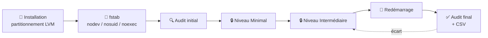
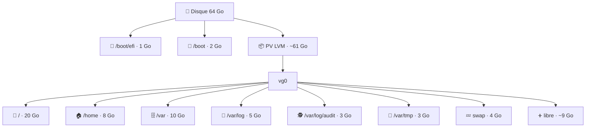

<div align="center">

# 🛡️ linux-hardening-anssi

**Audit et durcissement d'Ubuntu selon le guide ANSSI-BP-028 v2.0**
*« Recommandations de configuration d'un système GNU/Linux » — niveaux Minimal et Intermédiaire*


</div>

---

## 📑 Sommaire

- [✨ En bref](#-en-bref)
- [📦 Contenu du dépôt](#-contenu-du-dépôt)
- [🧭 Démarche globale](#-démarche-globale)
- [💽 Étape 1 — Installation et partitionnement](#-étape-1--installation-et-partitionnement)
- [🔑 Étape 2 — Accès SSH par clé](#-étape-2--accès-ssh-par-clé)
- [🔍 Étape 3 — Audit initial](#-étape-3--audit-initial)
- [🔒 Étape 4 — Durcissement](#-étape-4--durcissement)
- [✅ Étape 5 — Vérification après redémarrage](#-étape-5--vérification-après-redémarrage)
- [📋 Liste des 28 mesures](#-liste-des-28-mesures)
- [⚠️ Pièges connus sur Ubuntu](#️-pièges-connus-sur-ubuntu)
- [♻️ Sauvegardes et retour arrière](#️-sauvegardes-et-retour-arrière)
- [🛠️ Dépannage](#️-dépannage)
- [🗓️ Historique des versions](#️-historique-des-versions)
- [⚖️ Avertissement](#️-avertissement)

---

## ✨ En bref

| | |
| --- | --- |
| 🎯 **Objectif** | Amener un poste Ubuntu au niveau **Minimal** ou **Intermédiaire** du guide ANSSI-BP-028 et le prouver par un audit |
| 🔍 **Audit** | Contrôle en lecture seule, tableau coloré, export CSV pour la documentation |
| 🔒 **Durcissement** | Interactif, automatique ou mesure par mesure, avec simulation (`-n`) |
| 💾 **Sécurité** | Sauvegarde de chaque fichier modifié, journal de toutes les actions, validation `sshd -t` / `visudo` |
| 🔁 **Persistance** | Les contrôles vérifient la configuration chargée au prochain démarrage, pas seulement l'état en mémoire |
| 📊 **Résultat de référence** | 44 % après installation → **100 %** après durcissement et redémarrage (VM Ubuntu 24.04) |

---

## 📦 Contenu du dépôt

| Fichier | Rôle |
| --- | --- |
| 📚 `anssi-lib.sh` | Définition des 28 mesures : une fonction `check_<ID>` (contrôle) et une fonction `apply_<ID>` (correction) par mesure |
| 🔍 `anssi-audit.sh` | Audit en lecture seule, tableau de conformité, export CSV |
| 🔒 `anssi-harden.sh` | Durcissement : menu interactif, mode automatique, sélection d'IDs, simulation |
| 📄 `.gitattributes` | Force les fins de ligne Unix (LF) : un script en CRLF ne s'exécute pas sous Linux |

> 💡 L'audit et le durcissement appellent **les mêmes fonctions de contrôle** : ils ne peuvent pas être en désaccord sur ce qui est « conforme ».

---

## 🧭 Démarche globale



> 📸 **Sur une VM** (Proxmox, VirtualBox…), prenez un **snapshot avant chaque étape** : un retour arrière prend alors quelques secondes.

---

## 💽 Étape 1 — Installation et partitionnement

> ⚠️ **Le partitionnement se décide à l'installation.** C'est la seule mesure qu'on ne peut pas corriger après coup sans réinstaller (mesure I06).

### Pourquoi séparer les partitions ?

| Raison | Exemple |
| --- | --- |
| 🧱 **Limiter l'impact d'un remplissage** | Des journaux qui saturent `/var/log` ne bloquent pas tout le système |
| 🚫 **Appliquer des options restrictives** | `noexec` sur `/var/tmp` empêche d'y exécuter un binaire déposé par un attaquant |
| 📈 **Agrandir sans réinstaller** | Avec LVM, de l'espace libre dans le groupe de volumes permet d'étendre un volume à chaud |

### Options de montage

| Option | Effet |
| --- | --- |
| `nodev` | Interdit les fichiers de périphérique sur la partition |
| `nosuid` | Ignore les bits setuid/setgid des exécutables qui s'y trouvent |
| `noexec` | Interdit l'exécution directe de binaires depuis la partition |

### Schéma de référence (disque de 64 Go)

| | Volume | Taille | Système de fichiers | Point de montage | Options |
| --- | --- | --- | --- | --- | --- |
| 🥾 | Partition EFI *(UEFI uniquement)* | 1 Go | FAT32 | `/boot/efi` | `umask=0077` |
| 🥾 | Partition GPT | 2 Go | ext4 | `/boot` | `nodev,nosuid,noexec` |
| 🌳 | `vg0/lv_root` | 20 Go | ext4 | `/` | `defaults` |
| 🏠 | `vg0/lv_home` | 8 Go | ext4 | `/home` | `nodev,nosuid` |
| 🗄️ | `vg0/lv_var` | 10 Go | ext4 | `/var` | `nodev,nosuid` |
| 📜 | `vg0/lv_varlog` | 5 Go | ext4 | `/var/log` | `nodev,nosuid,noexec` |
| 🕵️ | `vg0/lv_audit` | 3 Go | ext4 | `/var/log/audit` | `nodev,nosuid,noexec` |
| 🧹 | `vg0/lv_vartmp` | 3 Go | ext4 | `/var/tmp` | `nodev,nosuid,noexec` |
| 💤 | `vg0/lv_swap` | 4 Go | swap | — | — |
| ⚡ | tmpfs *(créé par la mesure I05)* | RAM | tmpfs | `/tmp`, `/dev/shm` | `nodev,nosuid,noexec` |
| ➕ | Espace libre dans `vg0` | ~9 Go | — | — | Réserve pour agrandir un volume |



### Dans l'installateur Ubuntu Server (Subiquity)

1. Type d'installation : **Ubuntu Server (minimized)**.
2. Stockage : choisir **Custom storage layout**.
3. Sélectionner le disque → **Use As Boot Device**. Cela crée `/boot/efi` en UEFI, ou une partition `bios_grub` de 1 Mo en BIOS.
4. **free space** → **Add GPT Partition** : `2G`, ext4, montée sur `/boot`.
5. **free space** → **Add GPT Partition** : taille vide (tout le reste), **Leave unformatted**.
6. **Create volume group (LVM)** : nom `vg0`, cocher la partition de l'étape 5.
7. Pour chaque ligne `vg0/…` du tableau : **free space** de `vg0` → **Create Logical Volume**. Pour `/var/log`, `/var/log/audit` et `/var/tmp`, choisir **Other** dans le menu *Mount* et saisir le chemin.
8. Vérifier le **FILE SYSTEM SUMMARY**, puis **Done** → **Continue**.
9. Profil : un compte administrateur **nominatif**. Cocher **Install OpenSSH server**. Aucun *featured snap*.

> 🖥️ **UEFI recommandé.** Sur Proxmox, choisir **OVMF (UEFI)** avec un *EFI Disk* (clés pré-enrôlées) et un *TPM v2.0* : c'est plus proche d'un poste réel et cela permet de tester Secure Boot.

### Ajouter les options de montage dans `/etc/fstab`

L'installateur ne permet pas de saisir les options : on les ajoute après le premier démarrage.

```bash
sudo cp -a /etc/fstab /etc/fstab.orig

add_opts() {  # point_de_montage options
  sudo sed -i -E "s#^(\S+\s+$1\s+ext4\s+)defaults(\s)#\1defaults,$2\2#" /etc/fstab
}
add_opts /boot          nodev,nosuid,noexec
add_opts /home          nodev,nosuid
add_opts /var           nodev,nosuid
add_opts /var/log       nodev,nosuid,noexec
add_opts /var/log/audit nodev,nosuid,noexec
add_opts /var/tmp       nodev,nosuid,noexec

sudo findmnt --verify            # doit afficher « 0 errors »
sudo systemctl daemon-reload && sudo mount -a && sudo reboot
```

> 🔎 Le `\s` après le point de montage est indispensable : sans lui, la règle de `/var` modifierait aussi `/var/log` et `/var/log/audit`.

Vérification après redémarrage :

```bash
for m in /boot /home /var /var/log /var/log/audit /var/tmp; do findmnt -no TARGET,OPTIONS "$m"; done
```

> 🆘 Si le poste ne démarre plus, on arrive en mode secours : `cp /etc/fstab.orig /etc/fstab && reboot`.

---

## 🔑 Étape 2 — Accès SSH par clé

La mesure M06 propose de désactiver l'authentification SSH par mot de passe : **déployez et testez votre clé avant**.

Depuis Windows (PowerShell) :

```powershell
ssh-keygen -t ed25519                     # accepter le chemin par défaut, choisir une passphrase
type $env:USERPROFILE\.ssh\id_ed25519.pub | ssh <user>@<ip> "mkdir -p ~/.ssh && chmod 700 ~/.ssh && cat >> ~/.ssh/authorized_keys && chmod 600 ~/.ssh/authorized_keys"
ssh <user>@<ip>                           # ne doit plus demander le mot de passe du compte
```

Depuis Linux ou macOS : `ssh-copy-id <user>@<ip>`.

---

## 🔍 Étape 3 — Audit initial

```bash
git clone --depth 1 --branch v1.4 https://github.com/jfetx/linux-hardening-anssi.git
cd linux-hardening-anssi
sudo bash anssi-audit.sh -o audit-0-initial-$(hostname).csv
```

| Option | Rôle |
| --- | --- |
| `-l minimal` \| `-l intermediaire` | Niveau audité (défaut : `intermediaire`, qui inclut `minimal`) |
| `-o fichier.csv` | Export CSV (séparateur `;`, lisible dans Excel / LibreOffice) |

| Statut | Signification |
| --- | --- |
| 🟢 **CONFORME** | La mesure est appliquée et persistante |
| 🔴 **NON CONFORME** | À corriger avec `anssi-harden.sh` |
| 🟡 **À VÉRIFIER** | Décision humaine requise, à justifier dans la documentation |
| ⚪ **N/A** | Mesure sans objet sur ce poste (ex. pas de serveur SSH) |

---

## 🔒 Étape 4 — Durcissement

> 🧯 **Gardez une seconde session SSH ouverte** (ou la console de l'hyperviseur) pendant toute l'étape.

```bash
sudo bash anssi-harden.sh -n                      # 🧪 simulation : affiche, ne modifie rien
sudo bash anssi-harden.sh -l minimal              # 🖐️ interactif, mesure par mesure
sudo bash anssi-harden.sh -l intermediaire        # 🖐️ interactif, niveau complet
sudo bash anssi-harden.sh -l intermediaire -a     # 🤖 automatique (hors mesures sensibles)
sudo bash anssi-harden.sh -m I12                  # 🎯 une ou plusieurs mesures : -m M05,I12
```

| Option | Rôle |
| --- | --- |
| `-l niveau` | `minimal` ou `intermediaire` (sinon menu) |
| `-a` | Automatique : réponses par défaut, aucune question |
| `-n` | Simulation : rien n'est modifié |
| `-m ID,ID` | Ne traite que les mesures listées |

### 🚦 Mesures sensibles

Elles ne sont **jamais** appliquées en mode automatique, et posent toujours leurs questions :

| Mesure | Pourquoi | Conseil |
| --- | --- | --- |
| 🔌 **I04** — blocage du stockage USB | Clés et disques USB inutilisables | Les adaptateurs série/JTAG (`ftdi_sio`, `cdc_acm`) ne sont pas touchés : à tester avec votre matériel |
| 🥾 **I12** — mot de passe GRUB | Un mot de passe perdu bloque l'édition du démarrage | Le noter dans un coffre-fort ; le démarrage normal reste sans mot de passe |

### Réponses à surveiller en mode interactif

| Mesure | Question | Réponse conseillée |
| --- | --- | --- |
| M05 | *Autoriser SSH entrant ?* | **Oui**, sinon vous vous enfermez dehors |
| M06 | *Désactiver l'authentification par mot de passe ?* | **Oui** seulement si la clé fonctionne (étape 2) |
| M02 | *Activer les mises à jour automatiques ?* | Non par défaut : sur un banc de test, elles modifient l'environnement testé |
| I15 | *Retirer SUID de fusermount3 ?* | **Non** sur un poste graphique (gvfs, sshfs, AppImage) |

---

## ✅ Étape 5 — Vérification après redémarrage

```bash
sudo reboot
# … puis :
sudo bash anssi-audit.sh -o audit-final-$(hostname).csv
```

> 🔁 **L'audit après redémarrage est obligatoire.** Il prouve que les réglages survivent au démarrage (voir [pièges connus](#️-pièges-connus-sur-ubuntu)).

Tests fonctionnels à faire **en tant qu'utilisateur normal, pas en root** :

- [ ] 🔑 Connexion SSH par clé acceptée, par mot de passe refusée : `ssh -o PubkeyAuthentication=no <user>@<ip>`
- [ ] 🧑‍💼 `sudo -n true && echo OK`, et les commandes sont tracées dans `/var/log/sudo.log`
- [ ] 🔐 `passwd` demande le mot de passe actuel (annuler avec Ctrl+C)
- [ ] 🥾 Démarrage normal sans mot de passe ; touche `e` dans GRUB → identifiant demandé
- [ ] 🧩 Vos applications et votre matériel fonctionnent sur le poste durci

---

## 📋 Liste des 28 mesures

### 🟦 Niveau Minimal (13)

| ID | Thème | Mesure | Correction |
| --- | --- | --- | --- |
| M01 | 🔄 Mises à jour | Système à jour | ✅ auto |
| M02 | 🔄 Mises à jour | Mises à jour de sécurité automatiques | ✅ auto (défaut : non) |
| M03 | ✂️ Surface | Absence de paquets obsolètes (telnet, rsh, nis, tftp, ftp…) | ✅ auto |
| M04 | ✂️ Surface | Services inutiles désactivés (avahi, cups, bluetooth, rpcbind, samba…) | ✅ auto |
| M05 | 🧱 Réseau | Pare-feu ufw, entrant refusé par défaut | ✅ auto |
| M06 | 🔑 SSH | Root interdit, X11 et tunnels désactivés, journalisation | ✅ auto |
| M07 | 👤 Comptes | Mot de passe root verrouillé | ✅ auto |
| M08 | 🔐 Authentification | pam_pwquality : 12 caractères, 3 classes | ✅ auto |
| M09 | 📁 Fichiers | Droits restreints sur shadow, sudoers, sshd_config, grub.cfg | ✅ auto |
| M10 | 📁 Fichiers | Sticky bit sur les répertoires accessibles à tous | ✅ auto |
| M11 | 📁 Fichiers | Aucun fichier sans propriétaire | 👁️ contrôle seul |
| M12 | 🕐 Journalisation | Horloge synchronisée (NTP) | ✅ auto |
| M13 | 🕐 Journalisation | Journal systemd persistant | ✅ auto |

### 🟪 Niveau Intermédiaire (15)

| ID | Thème | Mesure | Correction |
| --- | --- | --- | --- |
| I01 | 🧠 Noyau / réseau | Paramètres réseau du noyau (redirections, rp_filter, log_martians…) | ✅ auto |
| I02 | 🧠 Noyau | Paramètres de sécurité du noyau (kptr, dmesg, ptrace, BPF, protected_*) | ✅ auto |
| I03 | 🧠 Noyau | Modules inutiles interdits (cramfs, hfs, dccp, sctp, firewire…) | ✅ auto |
| I04 | 🔌 Périphériques | Stockage USB bloqué | 🚦 sensible |
| I05 | 💽 Partitionnement | `/tmp` et `/dev/shm` en nodev,nosuid,noexec | ✅ auto |
| I06 | 💽 Partitionnement | Partitions séparées | 👁️ contrôle seul (à l'installation) |
| I07 | 🛡️ Contrôle d'accès | AppArmor actif, profils en mode enforce | ✅ auto |
| I08 | 🕵️ Journalisation | auditd avec règles ANSSI | ✅ auto |
| I09 | 👤 Comptes | sudo durci (use_pty, journal dédié, délai) | ✅ auto |
| I10 | 📁 Fichiers | umask 027 | ✅ auto |
| I11 | 🧠 Noyau | Core dumps désactivés | ✅ auto |
| I12 | 🥾 Démarrage | Mot de passe GRUB | 🚦 sensible |
| I13 | 👤 Comptes | Pas de mot de passe vide, pas d'UID 0 hors root | ✅ auto |
| I14 | 📁 Fichiers | Inventaire setuid/setgid | 👁️ à justifier |
| I15 | 📁 Fichiers | Bits SUID/SGID superflus retirés (`dpkg-statoverride`) | ✅ auto |

---

## ⚠️ Pièges connus sur Ubuntu

Trois composants d'Ubuntu **réécrivent des paramètres du noyau au démarrage**. Les scripts en tiennent compte depuis la v1.2.

| Paramètre | Valeur ANSSI | Réécrit par | Parade |
| --- | --- | --- | --- |
| `fs.protected_fifos` | 2 | `/usr/lib/sysctl.d/99-protect-links.conf` | Fichiers nommés `99-zz-anssi-*.conf` pour être lus en dernier |
| `net.ipv4.conf.*.log_martians` | 1 | ufw (`/etc/ufw/sysctl.conf`) | Valeur corrigée aussi dans ce fichier |
| `fs.suid_dumpable` | 0 | apport | Service apport désactivé |

> 🧪 `systemd-analyze cat-config sysctl.d` affiche l'ordre réel de lecture des fichiers sysctl.

Autres points utiles :

- 🧷 **SUID** : `chmod u-s` est annulé à la prochaine mise à jour du paquet ; `dpkg-statoverride` est persistant. Liste des exceptions : `sudo dpkg-statoverride --list`.
- 🛡️ **AppArmor** : les ~89 profils « unconfined » d'Ubuntu 24.04 servent à autoriser les espaces de noms utilisateur ; ce n'est **pas** un mode dégradé, contrairement au mode « complain ».

---

## ♻️ Sauvegardes et retour arrière

| Élément | Emplacement |
| --- | --- |
| 💾 Fichiers d'origine | `/var/backups/anssi-hardening/<date>/` (même arborescence) |
| 📝 Journal des actions | `/var/log/anssi-hardening.log` |

Annuler toutes les modifications d'une exécution :

```bash
B=/var/backups/anssi-hardening/<date>
sudo cp -a "$B"/. /     # restaure les fichiers d'origine
sudo reboot
```

> ℹ️ Les fichiers **créés** (et non modifiés) par les scripts apparaissent dans le journal sur les lignes `ECRITURE` ; ils se suppriment à la main.

---

## 🛠️ Dépannage

| Symptôme | Cause probable | Solution |
| --- | --- | --- |
| 🔒 Plus d'accès SSH après M06 | Clé non déployée | Console de l'hyperviseur : `sudo rm /etc/ssh/sshd_config.d/00-anssi.conf && sudo systemctl reload ssh` |
| 🧱 Plus d'accès réseau après M05 | SSH non autorisé dans ufw | Console : `sudo ufw allow OpenSSH` |
| 🔁 I01 / I02 / I11 non conformes après redémarrage | Version < v1.2 | Mettre à jour en v1.3, relancer `-m I01,I02,I11`, redémarrer |
| 🚫 `bash: ./anssi-audit.sh: Permission denied` | Bit d'exécution absent (ou partition `noexec`) | Lancer avec `sudo bash anssi-audit.sh` |
| `$'\r': command not found` | Fichier en fins de ligne Windows (CRLF) | `sed -i 's/\r$//' *.sh` (le `.gitattributes` l'évite) |
| 💽 Le poste ne démarre plus après `fstab` | Erreur de syntaxe | Mode secours : `cp /etc/fstab.orig /etc/fstab` |

---

## 🗓️ Historique des versions

| Version | Changements |
| --- | --- |
| **v1.4** | Correction `unprivileged_bpf_disabled` (valeur exacte 1) ; M14 bannière légale ; I16 `AllowGroups` SSH (sensible) ; droits `sudoers.d` et cron ; SSH `MaxSessions`/`TCPKeepAlive` ; sysctl `ldisc_autoload`, `core_uses_pid` ; services SAN/PackageKit/thermald/snapd — 30 mesures |
| **v1.3** | I07 passe automatiquement les profils AppArmor « complain » en « enforce » ; nouvelle mesure I15 (retrait SUID/SGID via `dpkg-statoverride`) — 28 mesures |
| **v1.2** | Les contrôles I01, I02 et I11 vérifient la configuration persistante, pas seulement l'état en mémoire |
| **v1.1** | Persistance des paramètres sysctl après redémarrage (ordre des fichiers, ufw, apport) |
| **v1.0** | Première version : audit + durcissement, 27 mesures |

---

## ⚖️ Avertissement

- 🧪 **Testez d'abord sur une VM** ou un poste non critique, avec `-n` pour simuler.
- 📖 Ces scripts **ne remplacent pas la lecture du guide** ANSSI-BP-028 (disponible sur [cyber.gouv.fr](https://cyber.gouv.fr/)) ; la correspondance avec ses numéros de recommandation (Rxx) est à établir dans votre documentation.
- 🎚️ Le **niveau attendu** (Minimal, Intermédiaire, Renforcé…) se décide avec le commanditaire, selon la sensibilité du système.
- 🏷️ Ce projet n'est ni produit, ni validé, ni certifié par l'ANSSI.

<div align="center">

Fait avec ☕ et beaucoup de snapshots Proxmox · [@jfetx](https://github.com/jfetx)

</div>
