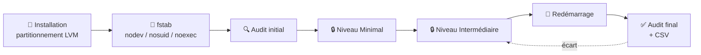
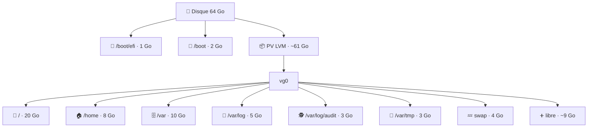

<div align="center">

# 🛡️ linux-hardening-anssi

**Audit et durcissement d'Ubuntu selon le guide ANSSI-BP-028 v2.0**
*« Recommandations de configuration d'un système GNU/Linux » — niveaux Minimal et Intermédiaire*


</div>

---

## 📑 Sommaire

- [✨ En bref](#-en-bref)
- [📦 Contenu du dépôt](#-contenu-du-dépôt)
- [🧭 Démarche globale](#-démarche-globale)
- [❓ Étape 0 — Questions à poser avant l'installation](#-étape-0--questions-à-poser-avant-linstallation)
- [💽 Étape 1 — Installation et partitionnement](#-étape-1--installation-et-partitionnement)
- [🔑 Étape 2 — Accès SSH par clé](#-étape-2--accès-ssh-par-clé)
- [🔍 Étape 3 — Audit initial](#-étape-3--audit-initial)
- [🔒 Étape 4 — Durcissement](#-étape-4--durcissement)
- [✅ Étape 5 — Vérification après redémarrage](#-étape-5--vérification-après-redémarrage)
- [📋 Liste des mesures](#-liste-des-mesures)
- [🐳 Docker et durcissement](#-docker-et-durcissement)
- [⚠️ Pièges connus sur Ubuntu](#️-pièges-connus-sur-ubuntu)
- [♻️ Sauvegardes et retour arrière](#️-sauvegardes-et-retour-arrière)
- [🛠️ Dépannage](#️-dépannage)
- [🗓️ Historique des versions](#️-historique-des-versions)
- [⚖️ Avertissement](#️-avertissement)

---

## ✨ En bref

| | |
| --- | --- |
| 🎯 **Objectif** | Amener un poste Ubuntu au niveau **Minimal** ou **Intermédiaire** du guide ANSSI-BP-028 et le prouver par un audit |
| 🔍 **Audit** | Contrôle en lecture seule, tableau coloré, export CSV pour la documentation |
| 🔒 **Durcissement** | Interactif, automatique ou mesure par mesure, avec simulation (`-n`) |
| 💾 **Sécurité** | Sauvegarde de chaque fichier modifié, journal de toutes les actions, validation `sshd -t` / `visudo` |
| 🔁 **Persistance** | Les contrôles vérifient la configuration chargée au prochain démarrage, pas seulement l'état en mémoire |
| 📊 **Résultat de référence** | 44 % après installation → **100 %** après durcissement et redémarrage (VM Ubuntu 24.04) |

---

## 📦 Contenu du dépôt

| Fichier | Rôle |
| --- | --- |
| 🟥 `anssi-lib-renforce.sh` | Niveau Renforcé : mesures simples (R01–R12) et points à étudier (R20–R27) |
| 📚 `anssi-lib.sh` | Définition des 28 mesures : une fonction `check_<ID>` (contrôle) et une fonction `apply_<ID>` (correction) par mesure |
| 🔍 `anssi-audit.sh` | Audit en lecture seule, tableau de conformité, export CSV |
| 🔒 `anssi-harden.sh` | Durcissement : menu interactif, mode automatique, sélection d'IDs, simulation |
| 📄 `.gitattributes` | Force les fins de ligne Unix (LF) : un script en CRLF ne s'exécute pas sous Linux |

> 💡 L'audit et le durcissement appellent **les mêmes fonctions de contrôle** : ils ne peuvent pas être en désaccord sur ce qui est « conforme ».

---

## 🧭 Démarche globale



> 📸 **Sur une VM** (Proxmox, VirtualBox…), prenez un **snapshot avant chaque étape** : un retour arrière prend alors quelques secondes.

---

## ❓ Étape 0 — Questions à poser avant l'installation

> 🎯 **Une réponse manquante = un problème après le durcissement.** Ces questions se posent **avant** d'installer, idéalement lors d'une journée de cadrage.

| Thème | Question | Pourquoi (mesure concernée) |
| --- | --- | --- |
| 🎚️ Niveau | Quel niveau ANSSI est attendu (Minimal, Intermédiaire, Renforcé) ? Un référentiel est-il imposé ? | Fixe le périmètre et la durée |
| 📦 Applications | Quels logiciels et **dépendances** installer (paquets, versions, Python, Java, Node…) ? Qui les installe ? | `noexec` sur `/tmp` (I05), umask 027 (I10), paquets retirés (M03) |
| 🐳 Conteneurs | Docker est-il utilisé ? Images disponibles sur un registre ou fournies en fichiers ? Versions figées ? | Partition dédiée, pare-feu (Docker contourne ufw), `ip_forward` (I01) |
| 🗄️ Base de données | Quel moteur (SQL Server, PostgreSQL, MySQL) ? En conteneur ou sur l'hôte ? Volume de données prévu ? | Taille de `/srv` ou `/var/lib/docker` |
| 🌐 Réseau | Ports à ouvrir ? Accès local uniquement ou depuis d'autres machines ? | Pare-feu (M05), publication des ports Docker |
| 📴 Connexion | Poste connecté à Internet ou isolé en production ? | Tout doit être installé **avant** la déconnexion |
| 🕐 Heure | Un serveur NTP interne sera-t-il disponible ? | Horodatage des journaux (M12) |
| 🔄 Mises à jour | Automatiques ou gérées par le client ? | M02 : écart à justifier si désactivées |
| 👥 Comptes | Combien d'administrateurs et d'utilisateurs ? Qui a besoin de SSH ? | sudo (I09), `AllowGroups` (I16), groupe `docker` |
| 🔑 SSH | Accès distant nécessaire ? Depuis quel réseau ? | M06, I16, règle ufw limitée au réseau d'administration |
| 🔌 Périphériques | Quels périphériques USB (souris, clavier, adaptateurs série, sondes) ? | Blocage du stockage USB (I04) |
| 💻 Matériel | Modèle, UEFI/Secure Boot, TPM, **taille et type du disque** (NVMe/SATA) ? Portable ? | Partitionnement, Wi-Fi, fermeture du capot |
| 🔐 Chiffrement | Chiffrement du disque exigé ? | Se décide **à l'installation** (LUKS) |
| 🖥️ Interface | Interface graphique nécessaire ? | Ubuntu Server ou Desktop, `fusermount3` (I15) |

> 📝 Toute réponse « non connue » devient une **hypothèse écrite** dans le bon de commande ou la documentation.

---

## 💽 Étape 1 — Installation et partitionnement

> ⚠️ **Le partitionnement se décide à l'installation.** C'est la seule mesure qu'on ne peut pas corriger après coup sans réinstaller (mesure I06).

### Pourquoi séparer les partitions ?

| Raison | Exemple |
| --- | --- |
| 🧱 **Limiter l'impact d'un remplissage** | Des journaux qui saturent `/var/log` ne bloquent pas tout le système |
| 🚫 **Appliquer des options restrictives** | `noexec` sur `/var/tmp` empêche d'y exécuter un binaire déposé par un attaquant |
| 📈 **Agrandir sans réinstaller** | Avec LVM, de l'espace libre dans le groupe de volumes permet d'étendre un volume à chaud |

### Options de montage

| Option | Effet |
| --- | --- |
| `nodev` | Interdit les fichiers de périphérique sur la partition |
| `nosuid` | Ignore les bits setuid/setgid des exécutables qui s'y trouvent |
| `noexec` | Interdit l'exécution directe de binaires depuis la partition |

### Schéma de référence (disque de 64 Go)

| | Volume | Taille | Système de fichiers | Point de montage | Options |
| --- | --- | --- | --- | --- | --- |
| 🥾 | Partition EFI *(UEFI uniquement)* | 1 Go | FAT32 | `/boot/efi` | `umask=0077` |
| 🥾 | Partition GPT | 2 Go | ext4 | `/boot` | `nodev,nosuid,noexec` |
| 🌳 | `vg0/lv_root` | 20 Go | ext4 | `/` | `defaults` |
| 🏠 | `vg0/lv_home` | 8 Go | ext4 | `/home` | `nodev,nosuid` |
| 🗄️ | `vg0/lv_var` | 10 Go | ext4 | `/var` | `nodev,nosuid` |
| 📜 | `vg0/lv_varlog` | 5 Go | ext4 | `/var/log` | `nodev,nosuid,noexec` |
| 🕵️ | `vg0/lv_audit` | 3 Go | ext4 | `/var/log/audit` | `nodev,nosuid,noexec` |
| 🧹 | `vg0/lv_vartmp` | 3 Go | ext4 | `/var/tmp` | `nodev,nosuid,noexec` |
| 💤 | `vg0/lv_swap` | 4 Go | swap | — | — |
| ⚡ | tmpfs *(créé par la mesure I05)* | RAM | tmpfs | `/tmp`, `/dev/shm` | `nodev,nosuid,noexec` |
| ➕ | Espace libre dans `vg0` | ~9 Go | — | — | Réserve pour agrandir un volume |



### 📏 Dimensionnement selon la taille du disque

Schéma pour un **poste avec Docker et une base de données** (le cas le plus exigeant). Les capacités sont **réelles** : un disque « 256 Go » offre environ 238 Gio.

| Volume | Options | 256 Go (~238 Gio) | 512 Go (~476 Gio) | 1 To (~931 Gio) |
| --- | --- | --- | --- | --- |
| 🥾 `/boot/efi` | `umask=0077` | 1 | 1 | 1 |
| 🥾 `/boot` | `nodev,nosuid,noexec` | 2 | 2 | 2 |
| 🌳 `/` | `defaults` | 30 | 40 | 50 |
| 🏠 `/home` | `nodev,nosuid` | 10 | 20 | 40 |
| 🗄️ `/var` | `nodev,nosuid` | 15 | 20 | 30 |
| 📜 `/var/log` | `nodev,nosuid,noexec` | 10 | 20 | 30 |
| 🕵️ `/var/log/audit` | `nodev,nosuid,noexec` | 5 | 10 | 15 |
| 🧹 `/var/tmp` | `nodev,nosuid,noexec` | 5 | 10 | 15 |
| 💤 swap | — | 8 | 16 | 16 |
| 🐳 `/var/lib/docker` | `defaults` (voir ci-dessous) | 70 | 150 | 300 |
| 🗃️ `/srv` (données, volumes BDD) | `nodev,nosuid,noexec` | 50 | 120 | 300 |
| ➕ **Libre dans `vg0`** | — | **~32 (13 %)** | **~67 (14 %)** | **~132 (14 %)** |

Repères de calcul :

- **Garder 10 à 15 % libres** dans le groupe de volumes : un volume plein s'agrandit à chaud (`lvextend -r`), sans réinstaller.
- **Swap** : 8 à 16 Gio suffisent sur un serveur sans mise en veille prolongée (hibernation).
- **`/var/lib/docker`** : taille des images × 2 (mises à jour, couches) + marge. Une image SQL Server pèse ~1,5 Go, PostgreSQL ~0,4 Go.
- **`/srv`** : volume de données de la base sur la durée de vie du poste × 2. **À demander au client** (Étape 0).
- **Poste sans Docker ni base** : supprimer `/var/lib/docker` et `/srv`, et reporter l'espace sur l'espace libre ou `/var`.

### 🐳 Cas particulier : poste avec Docker et base de données

| Choix | Raison |
| --- | --- |
| **Volume dédié `/var/lib/docker`** | Les images et couches ne saturent pas `/var` (recommandation du CIS Docker Benchmark) |
| `/var/lib/docker` en **`defaults`** | Docker gère ses propres montages (overlay) ; des options restrictives peuvent casser certains conteneurs. **À durcir seulement après tests** |
| **Données de la base dans `/srv`** (volume *bind mount*) | Les données survivent à la suppression d'un conteneur, sont faciles à sauvegarder et peuvent porter `nodev,nosuid,noexec` |
| Exemple | `docker run -v /srv/mssql:/var/opt/mssql …` ou `-v /srv/pgdata:/var/lib/postgresql/data …` |

Lignes `fstab` supplémentaires :

```bash
add_opts /srv nodev,nosuid,noexec
# /var/lib/docker reste en « defaults »
```

### 💻 Cas particulier : ordinateur portable utilisé comme serveur

| Point | Action |
| --- | --- |
| Disque NVMe | Le disque s'appelle `nvme0n1` (partitions `nvme0n1p1`…), pas `sda` |
| Fermeture du capot | `HandleLidSwitch=ignore` dans `/etc/systemd/logind.conf`, sinon le poste se met en veille |
| Wi-Fi / Bluetooth | Désactiver s'ils ne servent pas (`rfkill block all`, pilotes interdits) |
| Vol | Un portable se vole : sans chiffrement, le documenter comme **risque résiduel accepté** |

### Dans l'installateur Ubuntu Server (Subiquity)

1. Type d'installation : **Ubuntu Server (minimized)**.
2. Stockage : choisir **Custom storage layout**.
3. Sélectionner le disque → **Use As Boot Device**. Cela crée `/boot/efi` en UEFI, ou une partition `bios_grub` de 1 Mo en BIOS.
4. **free space** → **Add GPT Partition** : `2G`, ext4, montée sur `/boot`.
5. **free space** → **Add GPT Partition** : taille vide (tout le reste), **Leave unformatted**.
6. **Create volume group (LVM)** : nom `vg0`, cocher la partition de l'étape 5.
7. Pour chaque ligne `vg0/…` du tableau : **free space** de `vg0` → **Create Logical Volume**. Pour `/var/log`, `/var/log/audit` et `/var/tmp`, choisir **Other** dans le menu *Mount* et saisir le chemin.
8. Vérifier le **FILE SYSTEM SUMMARY**, puis **Done** → **Continue**.
9. Profil : un compte administrateur **nominatif**. Cocher **Install OpenSSH server**. Aucun *featured snap*.

> 🖥️ **UEFI recommandé.** Sur Proxmox, choisir **OVMF (UEFI)** avec un *EFI Disk* (clés pré-enrôlées) et un *TPM v2.0* : c'est plus proche d'un poste réel et cela permet de tester Secure Boot.

### Ajouter les options de montage dans `/etc/fstab`

L'installateur ne permet pas de saisir les options : on les ajoute après le premier démarrage.

```bash
sudo cp -a /etc/fstab /etc/fstab.orig

add_opts() {  # point_de_montage options
  sudo sed -i -E "s#^(\S+\s+$1\s+ext4\s+)defaults(\s)#\1defaults,$2\2#" /etc/fstab
}
add_opts /boot          nodev,nosuid,noexec
add_opts /home          nodev,nosuid
add_opts /var           nodev,nosuid
add_opts /var/log       nodev,nosuid,noexec
add_opts /var/log/audit nodev,nosuid,noexec
add_opts /var/tmp       nodev,nosuid,noexec

sudo findmnt --verify            # doit afficher « 0 errors »
sudo systemctl daemon-reload && sudo mount -a && sudo reboot
```

> 🔎 Le `\s` après le point de montage est indispensable : sans lui, la règle de `/var` modifierait aussi `/var/log` et `/var/log/audit`.

Vérification après redémarrage :

```bash
for m in /boot /home /var /var/log /var/log/audit /var/tmp; do findmnt -no TARGET,OPTIONS "$m"; done
```

> 🆘 Si le poste ne démarre plus, on arrive en mode secours : `cp /etc/fstab.orig /etc/fstab && reboot`.

---

## 🔑 Étape 2 — Accès SSH par clé

La mesure M06 propose de désactiver l'authentification SSH par mot de passe : **déployez et testez votre clé avant**.

Depuis Windows (PowerShell) :

```powershell
ssh-keygen -t ed25519                     # accepter le chemin par défaut, choisir une passphrase
type $env:USERPROFILE\.ssh\id_ed25519.pub | ssh <user>@<ip> "mkdir -p ~/.ssh && chmod 700 ~/.ssh && cat >> ~/.ssh/authorized_keys && chmod 600 ~/.ssh/authorized_keys"
ssh <user>@<ip>                           # ne doit plus demander le mot de passe du compte
```

Depuis Linux ou macOS : `ssh-copy-id <user>@<ip>`.

---

## 🔍 Étape 3 — Audit initial

```bash
git clone --depth 1 --branch v1.5.1 https://github.com/jfetx/linux-hardening-anssi.git
cd linux-hardening-anssi
sudo bash anssi-audit.sh -o audit-0-initial-$(hostname).csv
```

| Option | Rôle |
| --- | --- |
| `-l minimal` \| `-l intermediaire` | Niveau audité (défaut : `intermediaire`, qui inclut `minimal`) |
| `-o fichier.csv` | Export CSV (séparateur `;`, lisible dans Excel / LibreOffice) |

| Statut | Signification |
| --- | --- |
| 🟢 **CONFORME** | La mesure est appliquée et persistante |
| 🔴 **NON CONFORME** | À corriger avec `anssi-harden.sh` |
| 🟡 **À VÉRIFIER** | Décision humaine requise, à justifier dans la documentation |
| ⚪ **N/A** | Mesure sans objet sur ce poste (ex. pas de serveur SSH) |

---

## 🔒 Étape 4 — Durcissement

> 🧯 **Gardez une seconde session SSH ouverte** (ou la console de l'hyperviseur) pendant toute l'étape.

```bash
sudo bash anssi-harden.sh -n                      # 🧪 simulation : affiche, ne modifie rien
sudo bash anssi-harden.sh -l minimal              # 🖐️ interactif, mesure par mesure
sudo bash anssi-harden.sh -l intermediaire        # 🖐️ interactif, niveau complet
sudo bash anssi-harden.sh -l intermediaire -a     # 🤖 automatique (hors mesures sensibles)
sudo bash anssi-harden.sh -m I12                  # 🎯 une ou plusieurs mesures : -m M05,I12
```

| Option | Rôle |
| --- | --- |
| `-l niveau` | `minimal` ou `intermediaire` (sinon menu) |
| `-a` | Automatique : réponses par défaut, aucune question |
| `-n` | Simulation : rien n'est modifié |
| `-m ID,ID` | Ne traite que les mesures listées |

### 🚦 Mesures sensibles

Elles ne sont **jamais** appliquées en mode automatique, et posent toujours leurs questions :

| Mesure | Pourquoi | Conseil |
| --- | --- | --- |
| 🔌 **I04** — blocage du stockage USB | Clés et disques USB inutilisables | Les adaptateurs série/JTAG (`ftdi_sio`, `cdc_acm`) ne sont pas touchés : à tester avec votre matériel |
| 🥾 **I12** — mot de passe GRUB | Un mot de passe perdu bloque l'édition du démarrage | Le noter dans un coffre-fort ; le démarrage normal reste sans mot de passe |

### Réponses à surveiller en mode interactif

| Mesure | Question | Réponse conseillée |
| --- | --- | --- |
| M05 | *Autoriser SSH entrant ?* | **Oui**, sinon vous vous enfermez dehors |
| M06 | *Désactiver l'authentification par mot de passe ?* | **Oui** seulement si la clé fonctionne (étape 2) |
| M02 | *Activer les mises à jour automatiques ?* | Non par défaut : sur un banc de test, elles modifient l'environnement testé |
| I15 | *Retirer SUID de fusermount3 ?* | **Non** sur un poste graphique (gvfs, sshfs, AppImage) |

---

## ✅ Étape 5 — Vérification après redémarrage

```bash
sudo reboot
# … puis :
sudo bash anssi-audit.sh -o audit-final-$(hostname).csv
```

> 🔁 **L'audit après redémarrage est obligatoire.** Il prouve que les réglages survivent au démarrage (voir [pièges connus](#️-pièges-connus-sur-ubuntu)).

Tests fonctionnels à faire **en tant qu'utilisateur normal, pas en root** :

- [ ] 🔑 Connexion SSH par clé acceptée, par mot de passe refusée : `ssh -o PubkeyAuthentication=no <user>@<ip>`
- [ ] 🧑‍💼 `sudo -n true && echo OK`, et les commandes sont tracées dans `/var/log/sudo.log`
- [ ] 🔐 `passwd` demande le mot de passe actuel (annuler avec Ctrl+C)
- [ ] 🥾 Démarrage normal sans mot de passe ; touche `e` dans GRUB → identifiant demandé
- [ ] 🧩 Vos applications et votre matériel fonctionnent sur le poste durci

---

## 📋 Liste des mesures

### 🟦 Niveau Minimal (14)

| ID | Thème | Mesure | Correction |
| --- | --- | --- | --- |
| M01 | 🔄 Mises à jour | Système à jour | ✅ auto |
| M02 | 🔄 Mises à jour | Mises à jour de sécurité automatiques | ✅ auto (défaut : non) |
| M03 | ✂️ Surface | Absence de paquets obsolètes (telnet, rsh, nis, tftp, ftp…) | ✅ auto |
| M04 | ✂️ Surface | Services inutiles désactivés (avahi, cups, bluetooth, rpcbind, samba…) | ✅ auto |
| M05 | 🧱 Réseau | Pare-feu ufw, entrant refusé par défaut | ✅ auto |
| M06 | 🔑 SSH | Root interdit, X11 et tunnels désactivés, journalisation | ✅ auto |
| M07 | 👤 Comptes | Mot de passe root verrouillé | ✅ auto |
| M08 | 🔐 Authentification | pam_pwquality : 12 caractères, 3 classes | ✅ auto |
| M09 | 📁 Fichiers | Droits restreints sur shadow, sudoers, sshd_config, grub.cfg | ✅ auto |
| M10 | 📁 Fichiers | Sticky bit sur les répertoires accessibles à tous | ✅ auto |
| M11 | 📁 Fichiers | Aucun fichier sans propriétaire | 👁️ contrôle seul |
| M12 | 🕐 Journalisation | Horloge synchronisée (NTP) | ✅ auto |
| M13 | 🕐 Journalisation | Journal systemd persistant | ✅ auto |
| M14 | 🕐 Journalisation | Bannière légale (`/etc/issue`, `/etc/issue.net`) | ✅ auto |

### 🟪 Niveau Intermédiaire (16)

| ID | Thème | Mesure | Correction |
| --- | --- | --- | --- |
| I01 | 🧠 Noyau / réseau | Paramètres réseau du noyau (redirections, rp_filter, log_martians…) | ✅ auto |
| I02 | 🧠 Noyau | Paramètres de sécurité du noyau (kptr, dmesg, ptrace, BPF, protected_*) | ✅ auto |
| I03 | 🧠 Noyau | Modules inutiles interdits (cramfs, hfs, dccp, sctp, firewire…) | ✅ auto |
| I04 | 🔌 Périphériques | Stockage USB bloqué | 🚦 sensible |
| I05 | 💽 Partitionnement | `/tmp` et `/dev/shm` en nodev,nosuid,noexec | ✅ auto |
| I06 | 💽 Partitionnement | Partitions séparées | 👁️ contrôle seul (à l'installation) |
| I07 | 🛡️ Contrôle d'accès | AppArmor actif, profils en mode enforce | ✅ auto |
| I08 | 🕵️ Journalisation | auditd avec règles ANSSI | ✅ auto |
| I09 | 👤 Comptes | sudo durci (use_pty, journal dédié, délai) | ✅ auto |
| I10 | 📁 Fichiers | umask 027 | ✅ auto |
| I11 | 🧠 Noyau | Core dumps désactivés | ✅ auto |
| I12 | 🥾 Démarrage | Mot de passe GRUB | 🚦 sensible |
| I13 | 👤 Comptes | Pas de mot de passe vide, pas d'UID 0 hors root | ✅ auto |
| I14 | 📁 Fichiers | Inventaire setuid/setgid | 👁️ à justifier |
| I15 | 📁 Fichiers | Bits SUID/SGID superflus retirés (`dpkg-statoverride`) | ✅ auto |
| I16 | 🔑 SSH | Connexion SSH réservée au groupe `ssh-users` (`AllowGroups`) | 🚦 sensible |

### 🟥 Niveau Renforcé (`-l renforce`, depuis v1.5)

> ⚠️ Le niveau Renforcé n'est pas « un script de plus » : la moitié des points dépend des applications, de l'infrastructure ou du matériel. Le script applique les mesures **génériques** et **signale** les autres.

**Mesures simples (contrôle + correction)**

| ID | Mesure | Correction |
| --- | --- | --- |
| R01 | Options noyau au démarrage (`init_on_free`, `pti=on`, `vsyscall=none`…) | ✅ auto · 🔄 redémarrage |
| R02 | Verrouillage après 5 échecs (`pam_faillock`) | 🚦 sensible |
| R03 | umask 077 | ✅ auto |
| R04 | Répertoires personnels en 750 | ✅ auto |
| R05 | Aucun compilateur installé | ✅ auto |
| R06 | SSH : algorithmes restreints (guide ANSSI OpenSSH) | ✅ auto |
| R07 | Déconnexion des shells inactifs (`TMOUT=900`) | ✅ auto |
| R08 | Ctrl-Alt-Suppr désactivé | ✅ auto |
| R09 | Règles auditd verrouillées (`-e 2`) | ✅ auto · 🔄 redémarrage |
| R10 | Intégrité des fichiers (AIDE) | ✅ auto (plusieurs minutes) |
| R11 | Modules noyau bloqués après le démarrage | 🚦 sensible · 🔄 redémarrage |
| R12 | IPv6 désactivé s'il n'est pas utilisé | 🚦 sensible |

**Points à étudier (contrôle seul)**

| ID | Point | Dépend de |
| --- | --- | --- |
| R20 | Isolation des services systemd | Chaque service (`systemd-analyze security`) |
| R21 | Profils AppArmor des services exposés | Applications en écoute réseau |
| R22 | Journalisation centralisée | Un serveur de journaux |
| R23 | Règles sudo par commande | Les rôles des administrateurs |
| R24 | `/proc` avec `hidepid` | Outils de supervision, systemd-logind |
| R25 | USBGuard | Inventaire des périphériques légitimes |
| R26 | Chiffrement LUKS | Installation (phrase de passe ou TPM) |
| R27 | UEFI + Secure Boot, IOMMU | Matériel et micrologiciel |

---

## 🐳 Docker et durcissement

> 🔁 **Ordre d'installation** : Ubuntu → partitionnement → **Docker + applications + dépendances** → tests → durcissement → **tests à nouveau** → audit → déconnexion du réseau. Durcir avant d'installer les applications multiplie les problèmes.

| Point | Risque | Solution |
| --- | --- | --- |
| 🔴 **Docker contourne ufw** | Un port publié (`-p 1433:1433`) est joignable depuis le réseau **même si ufw le bloque** : Docker insère ses règles iptables avant celles d'ufw | Publier sur `127.0.0.1:1433:1433` si l'accès est local, ou filtrer dans la chaîne `DOCKER-USER` |
| 🟠 `ip_forward` | Docker en a besoin | Le script le conserve automatiquement si Docker est détecté (I01) : **installer Docker avant** |
| 🟠 Groupe `docker` | Appartenir au groupe `docker` **équivaut à être root** | Réservé aux administrateurs |
| 🟠 Images | En production hors ligne, une image manquante ne peut plus être téléchargée | Versions figées (pas de `latest`), copie de secours avec `docker save` |
| 🟢 auditd | Pas de règles Docker par défaut | Surveiller `/usr/bin/dockerd`, `/etc/docker`, `/var/lib/docker`, `docker.sock` |
| 🟢 Configuration du démon | Valeurs par défaut permissives | `/etc/docker/daemon.json` : `no-new-privileges`, `icc: false`, `live-restore`, limites de journaux |
| 🟢 Modules noyau | Docker charge des modules réseau à la volée | Compatible Intermédiaire ; **incompatible avec R11** (blocage des modules) sauf préchargement |

Exemple de `/etc/docker/daemon.json` :

```json
{
  "no-new-privileges": true,
  "icc": false,
  "live-restore": true,
  "userland-proxy": false,
  "log-driver": "json-file",
  "log-opts": { "max-size": "10m", "max-file": "3" }
}
```

> ⚠️ `icc: false` coupe la communication entre conteneurs du réseau par défaut : à tester si l'application est composée de plusieurs conteneurs (préférer alors un réseau Docker dédié).

---

## ⚠️ Pièges connus sur Ubuntu

Trois composants d'Ubuntu **réécrivent des paramètres du noyau au démarrage**. Les scripts en tiennent compte depuis la v1.2.

| Paramètre | Valeur ANSSI | Réécrit par | Parade |
| --- | --- | --- | --- |
| `fs.protected_fifos` | 2 | `/usr/lib/sysctl.d/99-protect-links.conf` | Fichiers nommés `99-zz-anssi-*.conf` pour être lus en dernier |
| `net.ipv4.conf.*.log_martians` | 1 | ufw (`/etc/ufw/sysctl.conf`) | Valeur corrigée aussi dans ce fichier |
| `fs.suid_dumpable` | 0 | apport | Service apport désactivé |

> 🧪 `systemd-analyze cat-config sysctl.d` affiche l'ordre réel de lecture des fichiers sysctl.

Autres points utiles :

- 🧷 **SUID** : `chmod u-s` est annulé à la prochaine mise à jour du paquet ; `dpkg-statoverride` est persistant. Liste des exceptions : `sudo dpkg-statoverride --list`.
- 🛡️ **AppArmor** : les ~89 profils « unconfined » d'Ubuntu 24.04 servent à autoriser les espaces de noms utilisateur ; ce n'est **pas** un mode dégradé, contrairement au mode « complain ».

---

## ♻️ Sauvegardes et retour arrière

| Élément | Emplacement |
| --- | --- |
| 💾 Fichiers d'origine | `/var/backups/anssi-hardening/<date>/` (même arborescence) |
| 📝 Journal des actions | `/var/log/anssi-hardening.log` |

Annuler toutes les modifications d'une exécution :

```bash
B=/var/backups/anssi-hardening/<date>
sudo cp -a "$B"/. /     # restaure les fichiers d'origine
sudo reboot
```

> ℹ️ Les fichiers **créés** (et non modifiés) par les scripts apparaissent dans le journal sur les lignes `ECRITURE` ; ils se suppriment à la main.

---

## 🛠️ Dépannage

| Symptôme | Cause probable | Solution |
| --- | --- | --- |
| 🔒 Plus d'accès SSH après M06 | Clé non déployée | Console de l'hyperviseur : `sudo rm /etc/ssh/sshd_config.d/00-anssi.conf && sudo systemctl reload ssh` |
| 🧱 Plus d'accès réseau après M05 | SSH non autorisé dans ufw | Console : `sudo ufw allow OpenSSH` |
| 🔁 I01 / I02 / I11 non conformes après redémarrage | Version < v1.2 | Mettre à jour en v1.3, relancer `-m I01,I02,I11`, redémarrer |
| 🚫 `bash: ./anssi-audit.sh: Permission denied` | Bit d'exécution absent (ou partition `noexec`) | Lancer avec `sudo bash anssi-audit.sh` |
| `$'\r': command not found` | Fichier en fins de ligne Windows (CRLF) | `sed -i 's/\r$//' *.sh` (le `.gitattributes` l'évite) |
| 💽 Le poste ne démarre plus après `fstab` | Erreur de syntaxe | Mode secours : `cp /etc/fstab.orig /etc/fstab` |

---

## 🗓️ Historique des versions

| Version | Changements |
| --- | --- |
| **docs** | README : questions préalables (Étape 0), dimensionnement 256 Go / 512 Go / 1 To, cas Docker + base de données, portables, section Docker |
| **v1.5.1** | R05 : `gcc-NN-base` (bibliothèque d'exécution) n'est plus pris pour un compilateur |
| **v1.5** | Module `anssi-lib-renforce.sh`, niveau `-l renforce` : 12 mesures simples (R01–R12, dont 3 sensibles) + 8 points à étudier en contrôle seul (R20–R27) |
| **v1.4.1** | M04 : test des snaps sur disque (la commande `snap` bloquait une fois snapd arrêté) ; sockets désactivés avant leurs services |
| **v1.4** | Correction `unprivileged_bpf_disabled` (valeur exacte 1) ; M14 bannière légale ; I16 `AllowGroups` SSH (sensible) ; droits `sudoers.d` et cron ; SSH `MaxSessions`/`TCPKeepAlive` ; sysctl `ldisc_autoload`, `core_uses_pid` ; services SAN/PackageKit/thermald/snapd — 30 mesures |
| **v1.3** | I07 passe automatiquement les profils AppArmor « complain » en « enforce » ; nouvelle mesure I15 (retrait SUID/SGID via `dpkg-statoverride`) — 28 mesures |
| **v1.2** | Les contrôles I01, I02 et I11 vérifient la configuration persistante, pas seulement l'état en mémoire |
| **v1.1** | Persistance des paramètres sysctl après redémarrage (ordre des fichiers, ufw, apport) |
| **v1.0** | Première version : audit + durcissement, 27 mesures |

---

## ⚖️ Avertissement

- 🧪 **Testez d'abord sur une VM** ou un poste non critique, avec `-n` pour simuler.
- 📖 Ces scripts **ne remplacent pas la lecture du guide** ANSSI-BP-028 (disponible sur [cyber.gouv.fr](https://cyber.gouv.fr/)) ; la correspondance avec ses numéros de recommandation (Rxx) est à établir dans votre documentation.
- 🎚️ Le **niveau attendu** (Minimal, Intermédiaire, Renforcé…) se décide avec le commanditaire, selon la sensibilité du système.
- 🏷️ Ce projet n'est ni produit, ni validé, ni certifié par l'ANSSI.

<div align="center">

Fait avec ☕ et beaucoup de snapshots Proxmox · [@jfetx](https://github.com/jfetx)

</div>
